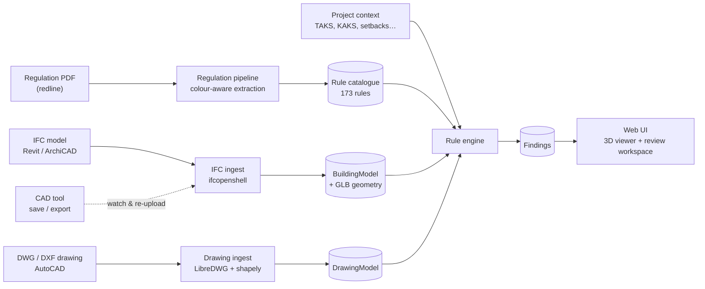

<div align="center">

# 🏗️ BIMCheck

### Building-regulation compliance checks for IFC and DWG models, reviewed right inside the 3D model.

*Drop in a design. Get every rule it breaks, with the offending element lit up in 3D, the measurement drawn on it, and the exact article of the regulation next to it.*


-red)

</div>

---

## The problem

Every municipality has its own zoning and building regulation. Today a plan reviewer checks a design against it by hand: pull up the PDF, find the article, measure the drawing, repeat for hundreds of rules. It is slow, and easy to get wrong.

## What BIMCheck does

You give it two things:

1. **A regulation**: currently the *Kayseri Büyükşehir Belediyesi İmar Yönetmeliği* (the 2022 redline PDF).
2. **A design**: an **IFC** model exported from Revit or ArchiCAD, and/or an **AutoCAD DWG/DXF** drawing.

It gives you:

- ✅ **Violations**: a measured value that breaks a rule (*"Door is 2.01 m high, minimum is 2.10 m, Madde 39(1)"*).
- 🟡 **Review items**: the tool couldn't decide alone: data missing, low-confidence measurement, or a legal exception might apply. It says why.
- 🟢 **Passes**: so you can see what *was* checked.
- 🖱️ **A review workspace**: click a finding and the camera flies to it, the offending element turns red, the measurement is drawn in 3D, the regulation text is shown, and you record your decision (*accept violation / waive / mark compliant / needs info*) on the spot.

It never silently guesses. Every number carries its source (`quantity`, `property`, `geometry` or `inferred`), and anything uncertain becomes a **review** instead of a false verdict.

## How it works



### 1. Regulation → machine-checkable rules
The source PDF is a **redline**: black text is unchanged, **red is added, grey is deleted**. Naive text extraction produces garbage like `5.50 6.50` (old value next to new). BIMCheck reads the colour of every text span, applies the amendments, and produces the *current in-force* text of **63 articles** with the revision history kept.

On top of that sits a catalogue of **173 rules**, each with a stable id (`KBB-28-4`), the article text, applicability conditions, the limit, exceptions, and an honest automation level:

| Level | Count | Meaning |
|---|---|---|
| `auto` | 7 | fully machine-checkable from a model |
| `semi` | 42 | engine pre-screens; edge cases go to a human |
| `manual` | 124 | catalogued so nothing is lost, but needs a human or documents outside the model |

### 2. Model → real measurements
- **IFC** (`ifcopenshell`): storeys, spaces (footprint polygon, net area, clear height, minimum width, usage from German/English/Turkish names), doors, windows (sizes, sill height), stairs (riser, tread, width, steps), railings, walls, slabs. Values are read from quantity sets first, then properties, then computed from geometry. Units are normalised to metres.
- **DWG/DXF** (`LibreDWG` WASM + `ezdxf` + `shapely`): layer-role mapping for Turkish and English layer names, unit detection (catches wrong headers), parcel polygon and area, building footprint, room names and labelled areas, and segmentation of a model space into plans, sections and elevations.
- The 3D geometry is exported as a **GLB with the axis conversion already applied**, so the building is always upright.

### 3. Rules → findings
A declarative evaluator handles simple *one measure vs one limit* rules. Custom checks cover the logic-heavy ones: stair riser and tread formulas, lift requirement, room minimum sizes, daylight to living rooms, door dimensions, **parcel setbacks** (with the +0.50 m per storey increment), TAKS/KAKS, storey limits, and more. A single broken rule never aborts a run. Finding ids are stable, so your review decisions survive a re-check.

### 4. Findings → review
The web UI (vanilla ES modules + three.js, works offline) shows the model next to the findings list:

- storey isolation (*only / up to / from*), horizontal **section cut**, per-class toggles (walls, slabs, roofs, ceilings, doors…), ghost/x-ray mode
- click a finding: fly-to, auto-hide ceilings above it, highlight offenders red and context amber, draw the 3D measurement
- regulation excerpt, measured vs required, provenance badge, decision form; keyboard shortcuts
- project settings (use, zone, storeys, TAKS/KAKS, setbacks…) and per-rule limit overrides
- live updates over WebSocket when a model is re-uploaded
- reports as **HTML, CSV, JSON** (and a minimal BCF zip)

## Quick start

```bash
git clone https://github.com/AtaGunZ/egg1.git
cd egg1
pip install -e .
npm install                 # needed for DWG reading (LibreDWG WASM)
python -m bimcheck serve    # → http://127.0.0.1:8765
```

Open the page, click **Load sample: Duplex** or **FZK-Haus**, and wait about 25 s while the model is processed. Or upload your own `.ifc` / `.dwg` with the buttons in the header.

### Command line

```bash
# offline check, prints violations and review items
python -m bimcheck check samples/Duplex_A_20110907.ifc

# IFC + drawing + project parameters
python -m bimcheck check model.ifc --drawing plan.dwg --context context.json --out report.json

# "real-time": re-upload to a running server every time the file is saved
python -m bimcheck watch model.ifc --drawing plan.dwg
```

### Tests

```bash
pip install -e ".[dev]"
python -m pytest
```

## Project layout

```
bimcheck/
  regulation/   PDF → articles.json, rule catalogue loader & validator
  ingest/ifc/   IFC → BuildingModel + GLB
  ingest/drawing/  DWG/DXF → DrawingModel
  engine/       rule evaluator, custom checks, review logic, finding diffs
  server/       FastAPI app, project storage, reports
  cli.py        check / watch / serve
web/            3D viewer and review UI
rules/          kayseri.rules.json, RULES.md (coverage), AUTHORING.md
regulation/     source PDF and extracted articles
connectors/     Revit and AutoCAD push sketches
docs/           ARCHITECTURE.md, CONTRACTS.md (data formats)
tests/
```

Start with [`docs/ARCHITECTURE.md`](docs/ARCHITECTURE.md) for the design and [`docs/CONTRACTS.md`](docs/CONTRACTS.md) for the exact data formats between subsystems. [`rules/RULES.md`](rules/RULES.md) lists which articles can be checked automatically and why the rest can't.

## Honest status

This is an **MVP**. It works end-to-end on the two sample IFCs, but:

- **Only 49 of 173 rules are machine-checked.** Many articles depend on things a model can't prove: terrain levels, heating type, occupancy, or other standards (TS 9111, fire regulations). They are listed as manual instead of silently skipped.
- **Setbacks, TAKS and KAKS need parcel data.** Enter it in the settings drawer, or provide a drawing that contains the parcel outline. Otherwise they show as *review*.
- **DWG room polygons are unreliable** when partitions aren't closed in the drawing. Parcel, units and room names/labels are much better.
- Only one regulation (Kayseri) is catalogued; adding another means writing a rule spec, see [`rules/AUTHORING.md`](rules/AUTHORING.md).
- The **Revit and AutoCAD connectors** in `connectors/` are untested sketches. The file watcher is the working route.
- Verdicts are a screening aid for a human reviewer, **not a legal compliance certificate**.

## Roadmap

- [ ] Native Revit / AutoCAD add-ins that zoom the CAD view to the failing element
- [ ] More regulations, with an LLM-assisted rule-extraction step
- [ ] Better room detection from DWG (closing partitions from door and wall symbols)
- [ ] Ramps, lift cars and roof overhangs as first-class elements, to unlock more rules
- [ ] Full BCF 2.1 round-trip with viewpoints

## Built with

[ifcopenshell](https://ifcopenshell.org) · [LibreDWG](https://www.gnu.org/software/libredwg/) via [libredwg-web](https://github.com/mlightcad/libredwg-web) · [ezdxf](https://ezdxf.mozman.at) · [shapely](https://shapely.readthedocs.io) · [PyMuPDF](https://pymupdf.readthedocs.io) · [FastAPI](https://fastapi.tiangolo.com) · [three.js](https://threejs.org)

The sample models are the public *AC20-FZK-Haus* (KIT) and *Duplex Apartment* (Autodesk Revit) IFC datasets.
